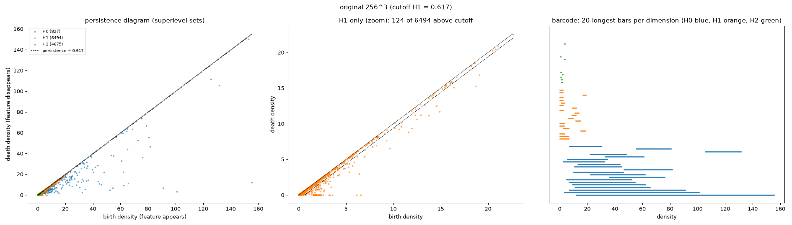
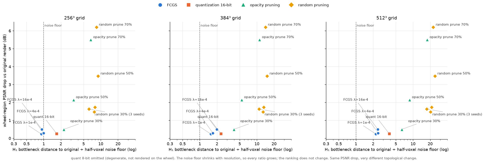
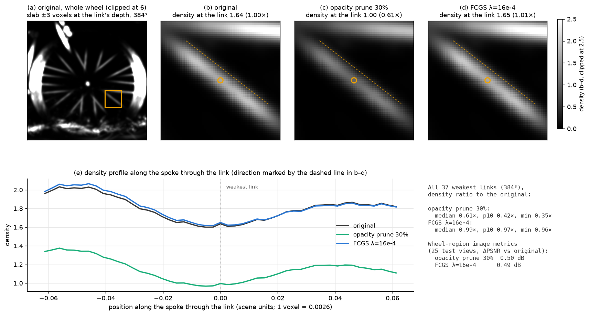
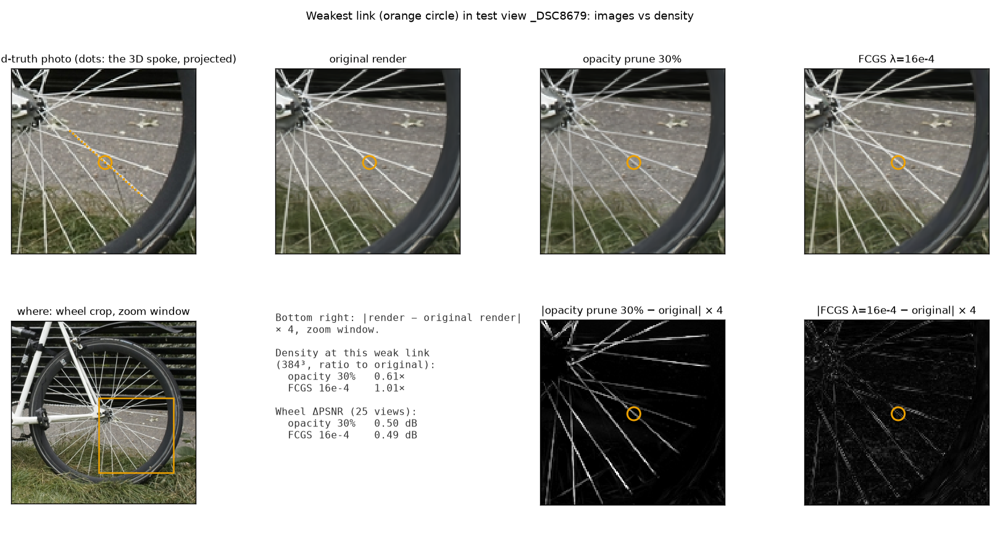
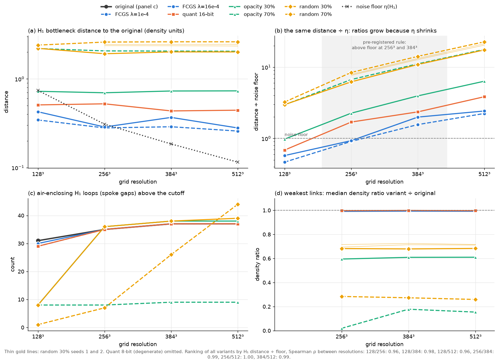
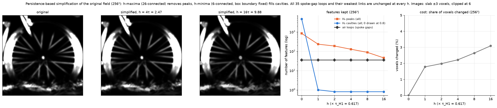

<div align="center">

**TOPOLOGICAL FIDELITY AUDIT OF COMPRESSED 3D GAUSSIAN SPLATTING**

A REPORT ON

PERSISTENT HOMOLOGY OF COMPRESSED 3DGS SCENES

By Balasubramanian

</div>

## 0.Table of contents

| Sno | Title |
|---|---|
| 1. | Introduction and scope |
| 2. | Background |
| 3. | Method |
| 4. | Setup, installation and reproducibility |
| 5. | Results and observations |
| 6. | Discussion and limitations |
| 7. | Conclusion and future work |
| 8. | References |

## 1.Introduction and scope

3D Gaussian Splatting (3DGS) represents a scene as millions of small 3D Gaussians, and the trained files are big (the bicycle scene I used is 1.52 GB). Because of this a lot of compression methods have come out, and almost all of them are judged by image metrics like PSNR, SSIM and LPIPS on test views plus the file size. The problem is that these metrics average over all the pixels. Thin things like bicycle spokes, wires or railings take up very few pixels, so a compressor can damage them and the scores will barely change.

In this project I wanted to check whether a topological measure computed on the 3D density can tell apart 2 compressed scenes that have the same image metrics, and whether that difference is real or just an artifact of how I sample the density. I picked the rear wheel of the Mip-NeRF 360 bicycle scene for this because the spokes are thin, there are a lot of them, and the gaps between them should show up as loops if the structure is still there.

This work mainly explores 4 things

1. Can a persistence diagram of the density field around the wheel see the spokes at all?
2. When two compressed versions have the same image quality, do they change the topology by the same amount?
3. Is the difference real, or does it change with the grid resolution?
4. What changed in 3D, and why do the image metrics miss it?

So in essence the contributions of this work are

1) a pipeline that takes a 3DGS .ply, samples a density field on a grid around the wheel, computes cubical persistence diagrams (H₀, H₁, H₂) and compares them with bottleneck and 2-Wasserstein distances
2) a noise floor from shifting the grid by half a voxel, fixed on the original model before I looked at any compressed model, plus a rule I fixed in advance that a change only counts if it is above the floor at both 256³ and 384³
3) an audit of 13 compressed variants (FCGS at 3 rates, 16 and 8 bit quantization, opacity and random pruning) at 128³ to 512³, along with image metrics on the full frame and on just the wheel
4) an audit of HAC against its own uncompressed baseline Scaffold-GS
5) a first try at simplifying the density field with persistence

SymGS, which I mentioned in the proposal, and the merge-tree metric were not done, and they are in future work.

The structure of the report is that in the next section I will go over the background on 3DGS compression and persistent homology, followed by the method. Then I describe the setup and the problems I ran into while reproducing everything. The main part is the results, where I go through the headline case, the image side, the resolution check, HAC and the simplification experiment. The last parts are the discussion, limitations and future work.

## 2.Background

A) 3DGS and its compression:

A 3DGS scene (Kerbl et al., 2023) is a set of 3D Gaussians. Each one has a centre, a scale and a rotation (together they give its covariance), an opacity, and spherical harmonic coefficients for colour. To render a view the Gaussians are projected onto the screen, sorted by depth and alpha blended front to back.

The compression methods I used fall into 3 groups. FCGS (Chen et al., 2025) and HAC (Chen et al., 2024) are entropy coders. FCGS keeps every Gaussian and codes their attributes with learned context models without any training per scene, and HAC compresses an anchor based model called Scaffold-GS (Lu et al., 2024). Quantization stores the attributes with fewer bits, so nothing is removed but the Gaussians move a little. Pruning removes the Gaussians that are ranked least important, usually by opacity or by an importance score like in LightGaussian (Fan et al., 2024). All of these are compared only with image metrics.

B) Persistent homology:

Take a density field f and a threshold t that starts at the maximum and slowly goes down. The superlevel set {f ≥ t} keeps growing. Persistent homology records when connected components (H₀), loops (H₁) and enclosed cavities (H₂) appear (birth) and disappear (death) during this sweep. Every feature becomes a point (birth, death) in a persistence diagram, and |birth − death|, its persistence, tells how robust it is. On a voxel grid this is done with a cubical complex, and GUDHI computes it on −f because a superlevel filtration of f is the same as the sublevel filtration of −f.

To compare 2 diagrams their points are matched. The bottleneck distance is the largest move in the best matching, so it reacts to the single biggest change, and the 2-Wasserstein distance is the square root of the sum of squared moves, so it reacts to lots of small changes. The stability theorem (Cohen-Steiner et al., 2007) says the bottleneck distance between the diagrams of f and g is at most max|f − g|. So a small change in the field can only move the diagram a little, and if the bottleneck distance is large then the field really changed somewhere.

## 3.Method

A) Density field:

Every Gaussian adds its opacity times its unnormalized Gaussian, so the density at a point x is:

```latex
d(x) = \sum_k o_k \exp\!\left(-\tfrac{1}{2}(x-\mu_k)^\top \Sigma_k'^{-1}(x-\mu_k)\right), \qquad \Sigma_k' = R_k\,(S_k^2 + f^2 I)\,R_k^\top
```

I used the sigmoid opacities and the exponentiated scales, same as the renderer. One problem I hit early was that trained 3DGS surfaces are made of flat or needle shaped Gaussians and a lot of them are thinner than a voxel, so whether a Gaussian shows up in the field depends on where the voxel centres happen to land. To fix this I widened every scale to √(s² + f²) with f = 0.0076562 scene units, which is fixed in world units for every resolution and variant (it is 2 voxels at 256³). Each Gaussian keeps its opacity, so its peak value stays the same. I also tried rescaling the opacity to keep the mass the same, but on the original model that erased the needle shaped spoke Gaussians, so I dropped it.

Each Gaussian is cut off at 4σ. I sampled the field in a box around the rear wheel of 0.98 × 0.22 × 0.98 scene units, lined up with the wheel plane, which I picked from scatter plots of the Gaussian centres. I name a grid by its resolution along the wheel plane, so 384³ actually means 384 × 87 × 384 voxels of 0.00255 units. I used 128³, 256³, 384³ and 512³.

B) Persistence and distances:

I computed cubical persistence with GUDHI 3.13 on −d, with the voxel values on the top dimensional cubes, which makes the superlevel sets 26-connected. The one infinite H₀ bar (the whole crop turning into one component at the end) is dropped. For every variant I computed the bottleneck and 2-Wasserstein distance (Hera, relative error 0.01) to the original's diagram for each dimension and resolution, always on the same grid.

C) Noise floor and decision rule:

A distance on its own does not mean much, it only means something compared to how much the diagram moves when nothing real has changed. So I sampled the original field a second time with every voxel centre shifted by half a voxel, and took the distance between the 2 diagrams as the noise floor η (Table 1). By the stability theorem a feature with persistence below 2η can be wiped out by a change of size η, so I used 2η as the cutoff for counting features. All distances in this report are given as multiples of η.

Table 1. Half voxel noise floor and cutoff for H₁ (density units), from the original model only.

| | 128³ | 256³ | 384³ | 512³ |
|---|---|---|---|---|
| η(H₁), bottleneck | 0.741 | 0.309 | 0.185 | 0.115 |
| cutoff τ(H₁) = 2η | 1.48 | 0.62 | 0.37 | 0.23 |

I fixed the floors, cutoffs, filter, crop and the air loop threshold on the original model before any compressed variant existed, and wrote them into a config file with dates. The 512³ values came later but still before I ran any 512³ variant. The decision rule was also fixed in advance: a topological change only counts if it is above the floor at both 256³ and 384³. If it shows up at only one resolution I treat it as a sampling artifact.

D) Air loops and weak links:

I call an H₁ loop air enclosing if its persistence is above the cutoff and it dies at a density below 0.05, which means the hole inside it is basically empty space. Around a spoke gap the loop is born at the voxel where the ring around the gap closes first as the threshold goes down. This is the lowest density point on the ring, so I call it the weakest link of that loop. GUDHI gives the cell that creates each pair, so I know the weak link voxel of every air loop in the original. Then I just read the ratio of a variant's density to the original's at those voxels, which tells me what happened in 3D at the most fragile places without needing any matching between diagrams.

E) Image metrics:

I rendered all models with the same 3DGS rasterizer at the 25 standard test views of bicycle (every eighth image, 1237 × 822). PSNR, SSIM and LPIPS (VGG) were computed against the photos on 3 regions: the full frame, the wheel box (the crop box projected into each view, about 9% of the frame) and spoke pixels (the original's spoke Gaussians projected into each view and dilated by 2 px, about 10.7% of the wheel box). I report every variant as a drop relative to the original render, so the differences come from compression and not from the original model's own error.

## 4.Setup, installation and reproducibility

A) Original model and variants:

I used the INRIA pretrained 3DGS model of bicycle (30k iterations). It has 6,131,954 Gaussians in a 1,520,726,124 byte .ply and scores 25.17 dB PSNR, 0.762 SSIM and 0.246 LPIPS on the 25 test views (24.40 dB on just the wheel box).

Table 2. Compressed variants.

| Variant | What it does | Size (ratio to original) |
|---|---|---|
| FCGS λ = 1e-4 / 4e-4 / 16e-4 | entropy codec, keeps all Gaussians | 116.7 / 90.0 / 67.3 MB (13× / 17× / 23×) |
| Quantization 16-bit / 8-bit | positions and log-scales quantized, then de-quantized | 96 / 48 bits per Gaussian for these attributes |
| Opacity pruning 30 / 50 / 70% | removes the lowest opacity Gaussians | 1.4× / 2.0× / 3.3× (.ply, not entropy coded) |
| Random pruning 30 / 50 / 70% | removes Gaussians at random (seeds 0, 1, 2 at 30%) | same as opacity pruning |

The other variants besides FCGS are simple controls that I made myself. Quantization moves every Gaussian a little without removing any. Opacity pruning removes the faintest Gaussians, which is usually the first step in real pruning methods. Random pruning removes the same number but with no preference, so comparing the 2 separates how many Gaussians are removed from which ones are removed. My variants are not entropy coded, so their sizes can't be compared with the FCGS bitstreams. The 8 bit quantization broke the scene (12 dB PSNR drop), so I only kept it as an extreme case.

B) HAC and Scaffold-GS:

HAC has no released checkpoint for bicycle, so I had to train HAC and its uncompressed base model Scaffold-GS myself with the authors' Mip-NeRF 360 settings for 30k iterations. Full resolution images do not fit on an 11 GB GPU, so I used the same setting as the HAC and Scaffold-GS papers, where the images are downscaled to 1600 px wide.

Table 3. HAC and Scaffold-GS trained on bicycle (each repository's own evaluation at 1600 px).

| Model | Test PSNR / SSIM / LPIPS | Size | Anchors |
|---|---|---|---|
| Scaffold-GS | 25.11 / 0.745 / 0.256 | 269 MB | 891,555 |
| HAC λ = 0.004 | 25.02 / 0.738 / 0.270 | 27.6 MB | 961,014 |

HAC is about 10 times smaller than Scaffold-GS for a 0.09 dB loss. These numbers are at a different resolution, so they shouldn't be compared with the original model's. The decoded HAC model is saved after entropy decoding, and when I reloaded it I got exactly the same test PSNR (25.0325 dB).

HAC can't just be converted into a Gaussian file, because anchor based models decode their Gaussians per camera. The positions don't depend on the camera, but opacity, scale, rotation and colour come out of small networks that take the viewing direction as input, and a Gaussian only exists where its opacity comes out positive. So I decoded all anchors without frustum culling for 8 fixed test cameras and averaged the 8 fields. I also added a second noise floor from how much Scaffold-GS's field changes between cameras, and compared HAC with Scaffold-GS, the same way FCGS is compared with the original.

C) Machines:

Fields, persistence and distances ran on my laptop CPU (8 cores, 31 GB RAM). FCGS, HAC, Scaffold-GS and all the renders ran on the IIIT cluster's RTX 2080 Ti nodes. As a sanity check, comparing the original with itself, and with a copy cropped on the cluster, gave a distance of exactly 0 at every resolution.

Table 4. Cost of persistence on the original model.

| Grid | Voxels | Time | Peak memory | Diagram points H₀ / H₁ / H₂ | Above cutoff H₀ / H₁ / H₂ |
|---|---|---|---|---|---|
| 128 × 29 × 128 | 0.48 M | 1.4 s | 0.25 GB | 656 / 3,159 / 1,674 | 36 / 63 / 3 |
| 256 × 58 × 256 | 3.8 M | 16 s | 1.5 GB | 827 / 6,494 / 4,675 | 40 / 124 / 4 |
| 384 × 87 × 384 | 12.8 M | 59 s | 4.8 GB | 895 / 10,676 / 9,468 | 59 / 156 / 7 |
| 512 × 115 × 512 | 30.1 M | 167 s | 10.9 GB | 916 / 16,421 / 17,064 | 72 / 193 / 11 |

The time grows faster than the number of voxels, and memory is what really limits the resolution. Most of the diagram points are short lived noise from the gaps between individual Gaussians and their number grows with resolution, while the features above the cutoff grow much more slowly.

D) Issues I ran into:

Everything is in the repository with an install log, so if you are trying to reproduce what I did, here are certain issues I encountered:

| Issue | Effect | Resolution |
|---|---|---|
| FCGS with its default setting ran out of memory on the 11 GB RTX 2080 Ti | Encoding crashed | Used a smaller per_step_size (400k instead of 1M); sizes still in the range the FCGS repo reports for bicycle |
| Cluster home directory was 97–99% full | Environments and model outputs did not fit | Cleaned old files, put large intermediate files on node-local scratch and copied only small results back |
| One long 512³ run on the laptop grew to 18 GB and the laptop ran out of memory | The whole session crashed | Ran each variant as its own process under a memory cap; opacity pruning 70% at 512³ needed 21 GB, so it ran on a cluster CPU node, which gave bit identical diagrams to the laptop |
| No released HAC checkpoint for bicycle, and the RTX 5080 machine had a driver mismatch | No pretrained HAC, no bigger GPU | Trained HAC and Scaffold-GS myself on the 2080 Ti at 1600 px |
| HAC and Scaffold-GS crashed at the final test render with images kept on the CPU | No model saved | Wrote a small wrapper that keeps images in RAM and moves them to the GPU when read |
| 9% of HAC's decoded Gaussians have a scale of exactly zero | My planned export rule (drop them) removed most of the spokes | Kept them, see section 5.F |

To check the setup I compared the original with itself after re-cropping on the cluster and got a distance of 0. The limitation is that everything was tested on one laptop and one cluster only.

## 5.Results and observations

A) Sanity checks and the original's loops:

The pipeline passed 11 sanity tests on synthetic scenes. One Gaussian gives one component, a ring of 24 Gaussians gives one long loop, a sphere shell gives one cavity, and removing the middle Gaussian of a line splits it into 2 components. The field code matches a brute force evaluation to 4.4e-16.

The original model has 31, 35, 37 and 37 air enclosing loops at 128³, 256³, 384³ and 512³ (Figure 1). GUDHI also gives the voxel where each loop's hole fills last, which tells me where the loop is. At 256³, 33 of the 35 are inside the wheel, spread around the whole circle between neighbouring spokes, and the other 2 are in the frame above it. When I counted the spokes by eye in the photos I got about 33. At 384³ there are 34 inside the wheel and 3 in the frame tubes next to the tyre. So the air loops are the spoke gaps, and their weak links are the thinnest points of the spokes and rim around each gap.



Fig1: The original field at 256³. Left: persistence diagram. Middle: H₁ only, the dashed line is the cutoff and 124 of 6,494 loops are past it; the points along the bottom that die at density near 0 are the air loops. Right: barcode of the 20 longest bars per dimension.

B) Image metrics against topology:

Table 5. Image drop relative to the original render (25 test views) and H₁ bottleneck distance as a multiple of the noise floor.

| Variant | ΔPSNR full (dB) | ΔPSNR wheel (dB) | B(H₁)/η at 256³ / 384³ | Air loops (384³) | Weak link ratio (384³) |
|---|---|---|---|---|---|
| FCGS λ = 1e-4 | 0.19 | 0.24 | 0.91 / 1.56 | 37 | 1.00 |
| FCGS λ = 4e-4 | 0.24 | 0.29 | 0.99 / 1.69 | 36 | 1.00 |
| FCGS λ = 16e-4 | 0.40 | 0.49 | 0.93 / 1.99 | 37 | 0.99 |
| Quantization 16-bit | 0.20 | 0.25 | 1.70 / 2.36 | 37 | 1.00 |
| Opacity pruning 30% | 0.19 | 0.50 | 2.26 / 3.95 | 38 | 0.61 |
| Opacity pruning 50% | 1.32 | 2.15 | 3.33 / 5.41 | 29 | 0.38 |
| Opacity pruning 70% | 5.88 | 5.51 | 6.69 / 11.13 | 9 | 0.18 |
| Random pruning 30% (3 seeds) | 2.23–2.38 | 1.48–1.73 | 6.2–7.9 / 10.9–13.2 | 38–40 | 0.68–0.72 |
| Random pruning 50% | 4.91 | 3.48 | 9.00 / 15.13 | 39 | 0.51 |
| Random pruning 70% | 8.36 | 6.20 | 8.42 / 14.16 | 26 | 0.27 |
| Quantization 8-bit (degenerate) | 12.05 | – | 10.62 / 17.75 | 0 | 0.00 |

Observations:

FCGS: Only FCGS stays below the floor at 256³, at every rate. At 384³ all 3 rates are just above it (1.6–2.0), so by my decision rule the FCGS change does not count. Quantization 16-bit passes the rule, but only because of 2 features inside the rim and tyre, not because of the spokes.

The headline pair: Opacity pruning 30% loses as much full frame PSNR as the mildest FCGS (0.19 dB) and the same wheel PSNR as the strongest FCGS (0.50 vs 0.49 dB). But its topological distance is 2.4 times that of FCGS λ = 16e-4 at 256³ and 2.0 times at 384³, and it passes the rule while FCGS doesn't. This is the case where image metrics and topology disagree.

Random pruning: It is much worse on both images and topology. Its loops still survive though, because it thins a spoke evenly instead of at its weakest points. Figure 2 puts everything together: at the same image loss the topological change differs by a factor of 2 to 4.



Fig2: Wheel PSNR drop against H₁ bottleneck distance divided by the noise floor, one panel per grid. FCGS λ = 16e-4 and opacity pruning 30% are at the same height but far apart horizontally.

C) What opacity pruning does to the spokes:

To see what actually changed I looked at the original's 37 weak links at 384³. Opacity pruning 30% keeps a median of 0.61 of the original density there (10th percentile 0.43, minimum 0.34), while typical spoke voxels keep 0.74. FCGS keeps 0.99–1.00 everywhere (Figure 3). Since the density is a sum over Gaussians and pruning only removes terms, this means about 40% of the density at the median weak link came from Gaussians that opacity pruning removed. These are the faint Gaussians that bridge the thinnest parts of each spoke.

Random pruning of 30% thins a spoke evenly: typical voxels keep 0.70–0.71 and weak links keep 0.68–0.72 over 3 seeds. So opacity pruning hits the weak links harder than the rest of the spoke (weak divided by typical is about 0.8, vs about 1 for random pruning). The single worst link is from a random seed though (0.24–0.29).

The spokes are weakened but not broken. The loop count stays at 38 (37 in the original) and no air loop disappears. The diagram moves because the birth density of each spoke gap loop goes down, usually from about 2.1 to 1.4. In the W2 matching, 60% of opacity pruning's cost is in the spoke band, while for FCGS and quantization about 70% is in the rim and tyre.

At 128³ opacity pruning keeps only 8 air loops. At first this looked strange, but it is expected: a link weakened to 0.6 × 1.96 ≈ 1.2 is below that grid's cutoff of 1.48, so the loop just isn't counted. This is exactly the kind of one resolution effect the decision rule is there to exclude.



Fig3: One weak link at 384³, picked as the spoke link whose opacity pruning ratio is the median (0.61), not the worst one. (a) The whole wheel in a thin slab through the link. (b–d) Zoom on one colour scale: density at the link is 1.64 (original), 1.00 (opacity pruning 30%) and 1.65 (FCGS λ = 16e-4). (e) Density along the spoke through the link.

D) Where the image error goes:

I wanted to know whether the images show this at all, so I projected the original's spoke Gaussians into all 25 test views and split each variant's squared error into spoke pixels and the rest of the wheel box.

Table 6. Image error on spoke pixels (10.7% of the wheel box) against the rest of the wheel box.

| Variant | Share of error on spokes | ΔPSNR spokes (dB) | ΔPSNR rest of wheel (dB) |
|---|---|---|---|
| Opacity pruning 30% | 30% | 1.03 | 0.39 |
| FCGS λ = 16e-4 | 16% | 0.57 | 0.48 |
| FCGS λ = 1e-4 / 4e-4, quantization 16-bit | 17–18% | 0.29–0.35 | 0.23–0.29 |
| Random pruning 30% (3 seeds) | 15–16% | 1.52–1.70 | 1.48–1.75 |

Observations:

Every method puts a bit more than 10.7% of its error on the spokes, because spokes are high contrast edges. FCGS, quantization and random pruning put 15–18% there, while opacity pruning puts 30%, about 3 times the spokes' share of pixels. So the difference can be seen in the images, but only at about a factor of 2 in dB, and only with a hand made mask that already uses the 3D information. The topological audit finds it without being told where the spokes are. Figure 4 shows the weak link from Figure 3 in a test view. So the way I state the result is: aggregate image metrics (full frame or wheel box) do not tell the 2 methods apart, while the topological audit does and also explains why.



Fig4: The weak link of Figure 3 projected into test view _DSC8679 (orange circle); the dots are the 3D spoke projected onto the photo, and they lie on an image spoke. Bottom right: |render − original render| × 4. The opacity pruning difference follows the spokes, the FCGS difference is spread out.

E) Stability across resolution:

Table 7. Absolute H₁ bottleneck distance (density units) and weak link ratio across resolution.

| | 128³ | 256³ | 384³ | 512³ |
|---|---|---|---|---|
| Noise floor η(H₁) | 0.741 | 0.309 | 0.185 | 0.115 |
| B(H₁), FCGS λ = 16e-4 | 0.43 | 0.29 | 0.37 | 0.28 |
| B(H₁), opacity pruning 30% | 0.73 | 0.70 | 0.73 | 0.73 |
| Weak link ratio, opacity pruning 30% | – | 0.59 | 0.61 | 0.61 |
| Weak link ratio, FCGS λ = 16e-4 | – | 0.99 | 0.99 | 0.99 |

Observations:

Ratios: The absolute distances barely change with resolution while the noise floor goes down by a factor of 6.4, so every ratio to the floor grows on finer grids (Figure 5). Because of this I read "above the floor" as a real change of the field and not a sampling artifact, not as a large change.

Ranking: What matters is that the ranking doesn't change. The Spearman correlation of all variants' ratios is 0.96–1.00 between any 2 resolutions (1.00 between 256³ and 512³), and the weak link ratios agree within 0.02 from 256³ to 512³.

Loop counts: The loop count of heavily pruned variants does go up with resolution (opacity 50%: 8, 16, 29, 33; random 70%: 1, 7, 26, 44), because a finer cutoff can resolve weakened links again. Random 70% even ends up with more loops than the original's 37, which means its structure is breaking into pieces.



Fig5: (a) Absolute H₁ distance stays flat while the noise floor (dotted) falls. (b) So every ratio grows, with the ranking unchanged. (c) Air loop counts. (d) Weak link ratios, flat from 256³ to 512³.

F) HAC against Scaffold-GS:

Before computing any topology I checked the export. All 194 training cameras of the HAC and Scaffold-GS models match the original model's (largest difference 1.9e-15), so the same crop box works. I picked 8 test cameras by their position in the test list before exporting anything. Rendering my exported Gaussians with the standard 3DGS rasterizer matches each repository's own render to 96–135 dB PSNR, each repository's test render matches its stored test images bit for bit, and exporting a camera again in a separate job gives identical arrays.

Since the decoded geometry changes with the camera, I needed a second noise floor. For Scaffold-GS I measured the largest bottleneck distance between one camera's field and the 8 camera mean. For H₁ this camera spread is 1.15, 1.14, 1.14 and 1.15 at 128³ to 512³, which is 4–7 times Scaffold-GS's half voxel floor (0.30, 0.23, 0.15, 0.18), so I used it as the floor. All floors were fixed before I computed any HAC distance.

Table 8. HAC against Scaffold-GS. Air loops use Scaffold-GS's own cutoff; 34 of its 38 loops at 384³ are in the spoke band.

| | 128³ | 256³ | 384³ | 512³ |
|---|---|---|---|---|
| H₁ bottleneck, HAC vs Scaffold-GS | 0.84 | 0.83 | 0.88 | 0.86 |
| ÷ camera spread floor | 0.73 | 0.73 | 0.78 | 0.75 |
| ÷ half voxel floor | 2.8 | 3.7 | 5.8 | 4.9 |
| Air loops, Scaffold-GS / HAC | 36 / 36 | 38 / 38 | 38 / 40 | 38 / 39 |
| Weak link ratio, HAC ÷ Scaffold-GS (median) | 1.07 | 1.09 | 1.08 | 1.09 |

Observations:

Result: The decision rule is not met. HAC changes the field more than grid sampling explains (2.8–5.8 times the half voxel floor), but less than one camera's decode of Scaffold-GS differs from the average. Scaffold-GS has the spoke gaps, HAC keeps all of them, and its median weak link is as dense as Scaffold-GS's (compare 0.61 for opacity pruning 30%). On images HAC loses 0.09 dB test PSNR and is 0.04 dB better on the wheel box (approximate, since I had to resize the 1600 px renders). So at λ = 0.004 HAC can't be told apart from its baseline, and it is not a disagreement case.

The export problem: This was the most surprising part. The rule I had fixed in advance dropped Gaussians with a decoded scale of exactly zero, because I expected them to be rare (about 0.2%). They turned out to be 9% of HAC's Gaussians and 18–23% inside the wheel box, because HAC's quantizer rounds small scales to zero. And they are visible: without them HAC's render loses most of the spokes (22–32 dB against its own render). My field also doesn't need them dropped, since the filter gives every axis a thickness of at least f. The rule failed its own check, so I changed it to keep them, before computing any HAC field. When I ran the drop rule anyway as a side check, HAC's air loops fell from 38 to 13 and 17, the median weak link to 0.56 and 0.51, and HAC would have "passed" the rule at 1.15 times the floor. So for anchor based codecs the exported Gaussians have to be checked against the codec's own renders first, otherwise the topology can't be trusted.

G) Persistence based simplification (exploratory):

As a first step towards topology-aware compression I simplified the original field with 2 exact operators from mathematical morphology. Each one changes the field by at most a chosen amount h, so every diagram moves by at most h. The h-maxima transform removes every peak (H₀) with persistence below h, using 26-connectivity like the cubical complex. The h-minima transform fills every enclosed cavity (H₂) shallower than h, using the dual 6-connectivity, with the box boundary kept fixed so that open air isn't treated as a cavity. There is no operator like this for loops alone in 3D, so I only watched the loops. I varied h from 1 to 16 times the H₁ cutoff.

Table 9. Simplification of the original field at 256³.

| | Original | h = 1×τ | h = 4×τ | h = 16×τ |
|---|---|---|---|---|
| h (density units) | 0 | 0.62 | 2.47 | 9.88 |
| Peaks H₀, all / above cutoff | 827 / 40 | 230 / 39 | 126 / 36 | 45 / 21 |
| Cavities H₂, all / above cutoff | 4,675 / 4 | 1 / 1 | 0 / 0 | 0 / 0 |
| Loops H₁ above cutoff | 124 | 124 | 124 | 124 |
| Air loops (spoke gaps) | 35 | 35 | 35 | 35 |
| Weak link ratio | 1 | 1.00 | 1.00 | 1.00 |
| Voxels changed | 0 | 1.8% | 2.2% | 3.1% |
| H₁ bottleneck ÷ η | 0 | 0.01 | 0.01 | 0.99 |

Observations:

Almost all peaks and cavities could be removed without changing a single spoke loop, and only 2–3% of the voxels changed. 384³ gave the same thing: peaks went from 895 to 79, cavities from 9,468 to 0, and all 37 air loops and weak links stayed the same. Only the strongest settings (8–16 times) move the H₁ diagram noticeably, by up to 1.6 noise floors, and not at the spoke gaps (Figure 6). My first 2 attempts at this were wrong: without fixing the box boundary the h-minima raised all the open air and no spoke gap counted as a loop anymore, and with the wrong connectivity about 3,900 cavities survived. Both were fixed before the numbers above.

This hints at what a topology-aware compressor could do: remove what only adds short lived peaks and cavities, and protect what holds the long lived loops together, which is the opposite of what opacity pruning does at the weak links. The simplified field is not a set of Gaussians though, and turning it back into a model that can be rendered is future work. The roughly 6,200 short lived loops are also left as they are, since there is no loop only operator.



Fig6: Left: the wheel before simplification and at h = 4 and 16 times the cutoff; spokes, gaps and rim look the same. Right: features kept (log scale) and share of voxels changed, against h.

## 6.Discussion and limitations

Image metrics check whether the scene looks the same from the test cameras, and my audit checks whether the same 3D structure is there. For a realistic pair of methods on bicycle these give different answers, and the audit also shows the reason, which is faint bridging Gaussians removed at the thinnest parts of the spokes. Pruning by opacity is the most exposed, because on thin structures low opacity doesn't mean low importance.

The spokes are weakened, not broken, since every air loop survives. Bigger pruning (50% and 70%) does break them, but then the image metrics also drop a lot and there is no disagreement left. So the result is really about how much structural margin is left at the same image quality.

Both published codecs (FCGS at 3 rates, HAC at 1) kept the wheel's topology, and the damage came from removing Gaussians, not from coding their attributes. I don't think this makes topology-aware compression useless, since most practical pipelines prune or mask Gaussians at some point (HAC has a learned mask too), I only tested moderate rates, and thin structures matter for more than images, for example meshing or collision. The point is that pruning should know which Gaussians hold thin structures together, and the audit can check whether it did.

The limitations are:

1. I only studied one region of one scene, and other thin structures (wires, railings, plants) and other scenes may behave differently.
2. Opacity and random pruning are simple controls. LightGaussian's real score also uses volume and how often a Gaussian is seen in training views, and I did not test it.
3. The field sums opacity weighted Gaussians and ignores colour and view dependence, while the renderer blends front to back. So the field shows where matter is, not what it looks like.
4. The filter width, crop and air loop threshold affect the numbers. I fixed them before analysing any variant, but other reasonable choices would give somewhat different values. The 0.05 air threshold also leaves out 4 loops in the wheel whose holes are almost empty (0.07–0.13), so 34 spoke gaps is a slight undercount.
5. The half voxel floor only covers sampling error, not the difference between 2 training runs of the same model.
6. FCGS ran with a smaller per_step_size to fit in memory. Its sizes are in the range its authors report, but the results aren't guaranteed to match the default setting.
7. HAC and Scaffold-GS were trained at 1600 px, so their image numbers can't be compared with the 3DGS models. Their field is a choice I made (mean over 8 cameras), and the camera spread floor is conservative, so it could miss a real HAC change, which is why I also give the half voxel ratios. I only tested one HAC rate.

## 7.Conclusion and future work

A persistence audit of the density field, with a noise floor fixed in advance and checked at 4 resolutions, can separate compressed 3DGS models that aggregate image metrics treat as the same. On the bicycle wheel, opacity pruning 30% and FCGS λ = 16e-4 lose the same wheel PSNR (0.50 and 0.49 dB), but opacity pruning moves the H₁ diagram twice as far and removes about 40% of the density at the spokes' weak links, while FCGS leaves them alone. The ranking of all 13 variants stays the same from 128³ to 512³, and HAC keeps every spoke loop of its baseline once its exported Gaussians are checked properly.

Future work:

1. Topology-guided pruning: before removing a Gaussian, check whether it carries a large share of the density at a weak link, keep it if it does, and compare with opacity pruning at the same size.
2. Run LightGaussian's importance score and see whether it also hits the weak links.
3. Push FCGS and HAC to higher compression to find where the spokes break.
4. Apply the audit to SymGS and to other scenes (Tanks and Temples, Deep Blending).
5. The merge-tree distance from the proposal, and converting the simplified field back into Gaussians.
6. A noise floor from different training seeds.

## 8.References

1. Kerbl, B., Kopanas, G., Leimkühler, T., Drettakis, G. 3D Gaussian Splatting for Real-Time Radiance Field Rendering. ACM TOG (SIGGRAPH), 2023.
2. Barron, J. T. et al. Mip-NeRF 360: Unbounded Anti-Aliased Neural Radiance Fields. CVPR, 2022.
3. Chen, Y. et al. Fast Feedforward 3D Gaussian Splatting Compression (FCGS). ICLR, 2025.
4. Chen, Y. et al. HAC: Hash-grid Assisted Context for 3D Gaussian Splatting Compression. ECCV, 2024.
5. Lu, T. et al. Scaffold-GS: Structured 3D Gaussians for View-Adaptive Rendering. CVPR, 2024.
6. Fan, Z. et al. LightGaussian: Unbounded 3D Gaussian Compression with 15× Reduction and 200+ FPS. NeurIPS, 2024.
7. Topology-GS. 2025. (Full citation to be confirmed.)
8. SymGS. (Full citation to be confirmed.)
9. Cohen-Steiner, D., Edelsbrunner, H., Harer, J. Stability of Persistence Diagrams. Discrete & Computational Geometry, 2007.
10. Edelsbrunner, H., Harer, J. Persistent Homology, a Survey. Contemporary Mathematics 453, 2008.
11. The GUDHI Project. GUDHI User and Reference Manual, version 3.13.
12. Kerber, M., Morozov, D., Nigmetov, A. Geometry Helps to Compare Persistence Diagrams. ACM JEA, 2017.
13. Wang, Z., Bovik, A. C., Sheikh, H. R., Simoncelli, E. P. Image Quality Assessment: From Error Visibility to Structural Similarity. IEEE TIP, 2004.
14. Zhang, R. et al. The Unreasonable Effectiveness of Deep Features as a Perceptual Metric. CVPR, 2018.

The code, configs and results are in the project repository. The settings I fixed in advance are in configs/analysis.yaml, and the README lists the script and output behind every figure and table.

AI assistance: implementation, experiment orchestration and drafting were assisted by Claude (Anthropic). Design decisions, checkpoints and the interpretation of results were reviewed by me.
